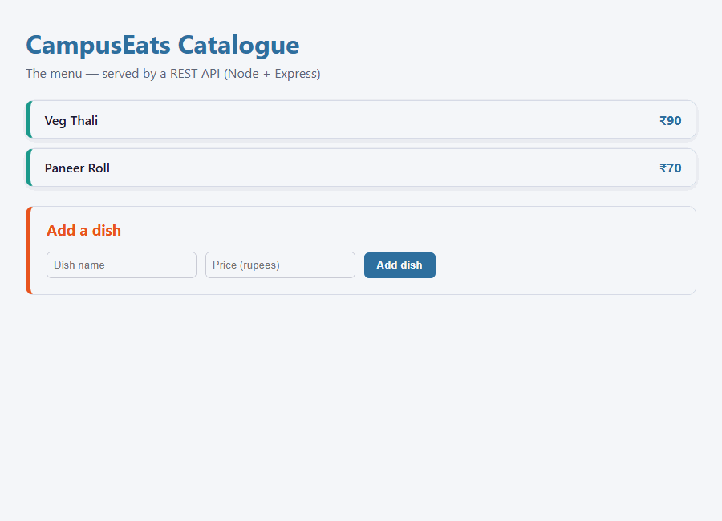

# CS543 Web Services · Tutorial 8: Node & Express
## Build One Small Service End to End — HTML/CSS → REST API (Node + Express) → Data

[]()
[]()
[]()
[]()

---

## 🎬 Working Demonstration Videos & Media

This implementation includes high-definition working demonstrations:

| Format | File Link | Description | Compatibility |
| :--- | :--- | :--- | :--- |
| **MP4 Video (Recommended)** | [**`demonstration.mp4`**](demonstration.mp4) | Standard H.264 video recording of the live app | Opens natively in Windows Media Player, Movies & TV, VLC, mobile phones |
| **Interactive Player** | [**`demonstration.html`**](demonstration.html) | Modern browser video player with controls & API specs | Open in Edge, Chrome, Firefox, or Safari |
| **WebM Video** | [**`demonstration.webm`**](demonstration.webm) | High-definition WebM format video | All modern web browsers |
| **Animated GIF** | [**`demonstration.gif`**](demonstration.gif) | Auto-looping animated demonstration | Embedded below; views anywhere without player |

### 🎞️ Live Demonstration Preview (Auto-Loop):


---

## 🏗️ The Three-Layer Architecture

The browser never touches the data directly — it only sends HTTP requests to the REST API, and the Express route handlers read and write the data:

```
Browser (Front-end UI) ──HTTP REST (JSON)──> REST API (Node + Express) ──In-Memory──> Data (items array)
```

1. **Front-End Layer (`public/index.html`, `public/style.css`):**
   - Clean, modern, responsive UI with culinary badges, live counter, and dynamic toast notifications.
   - Uses browser `fetch()` for seamless asynchronous HTTP requests (`GET /items` to render, `POST /items` to create).
2. **REST API Server Layer (`server.js`):**
   - Powered by **Node.js** and **Express.js** running on `http://localhost:3000`.
   - Parses incoming JSON request payloads via `express.json()`.
   - Exposes RESTful endpoints with standard HTTP status codes (`200 OK`, `201 Created`, `404 Not Found`, `422 Unprocessable Entity`).
3. **Data Layer (In-Memory Array):**
   - An in-memory JavaScript array `items = [...]` holding dish objects `{ id, name, price }`.

---

## 📂 Project Structure

```
Tut_8/
├── server.js               # Express REST API server
├── package.json            # Project dependencies (express)
├── public/                 # Static front-end assets
│   ├── index.html          # Modern web UI with fetch() and submission form
│   └── style.css           # Premium card layout, badges & animations
├── demonstration.mp4       # Universal H.264 MP4 video (Opens in Windows Media Player)
├── demonstration.webm      # High-Definition WebM video
├── demonstration.gif       # Universal animated demonstration GIF
├── demonstration.html      # Interactive video playback page
├── record_demo.js          # Automated headless browser recorder script
├── make_video.py           # Frame assembly script
└── README.md               # Complete tutorial documentation
```

---

## 🔌 REST API Endpoints Specification

| Method | Endpoint | Description | Request Body | Status Code & Response |
| :--- | :--- | :--- | :--- | :--- |
| **GET** | `/items` | List all menu dishes | None | `200 OK` + JSON Array of dishes |
| **GET** | `/items/:id` | Get specific dish by ID | None | `200 OK` (Found) or `404 Not Found` (`{"error":"not found"}`) |
| **POST** | `/items` | Add a new dish to the menu | `{"name": "...", "price": ...}` | `201 Created` + new dish, or `422 Unprocessable` (`{"error":"name required"}`) |

---

## 🛠️ Step-by-Step Implementation Walkthrough

### Part 1: Project Setup
```bash
npm init -y
npm install express
```

### Part 2 & 3: The Express Server & Read Routes (`server.js`)
```javascript
const express = require('express');
const app = express();

app.use(express.json());          // read JSON request bodies
app.use(express.static('public')); // serve static web page from public/

let items = [
  { id: 1, name: 'Veg Thali', price: 90 },
  { id: 2, name: 'Paneer Roll', price: 70 },
];
let nextId = 3;

// GET /items -- list whole menu
app.get('/items', (req, res) => {
  res.json(items);
});

// GET /items/:id -- one dish, or 404
app.get('/items/:id', (req, res) => {
  const item = items.find(i => i.id === Number(req.params.id));
  if (!item) return res.status(404).json({ error: 'not found' });
  res.json(item);
});
```

### Part 4: Add a Dish Write Route (`POST /items`)
```javascript
app.post('/items', (req, res) => {
  const { name, price } = req.body;
  if (!name) return res.status(422).json({ error: 'name required' });
  const item = { id: nextId++, name, price: Number(price) || 0 };
  items.push(item);
  res.status(201).json(item); // 201 Created
});

app.listen(3000, () => console.log('Catalogue on http://localhost:3000'));
```

### Part 5: The Frontend (`public/index.html`)
The page performs the full request-response lifecycle:
1. **Initial Load:** Calls `GET /items` to render the existing menu with icons and price tags.
2. **Form Submission:** Sends `POST /items` with JSON payload `{ name, price }`, shows a confirmation toast, resets inputs, and dynamically refreshes the list without page reload.

---

## 🧪 Verified Terminal Testing (`curl`)

### 1. List entire menu (`GET /items`):
```bash
curl -i http://localhost:3000/items
```
**Output:**
```http
HTTP/1.1 200 OK
Content-Type: application/json; charset=utf-8

[{"id":1,"name":"Veg Thali","price":90},{"id":2,"name":"Paneer Roll","price":70}]
```

### 2. Fetch single item (`GET /items/1`):
```bash
curl -i http://localhost:3000/items/1
```
**Output:**
```http
HTTP/1.1 200 OK

{"id":1,"name":"Veg Thali","price":90}
```

### 3. Missing item 404 response (`GET /items/99`):
```bash
curl -i http://localhost:3000/items/99
```
**Output:**
```http
HTTP/1.1 404 Not Found

{"error":"not found"}
```

### 4. Create new dish (`POST /items`):
```bash
curl -i -X POST http://localhost:3000/items \
  -H "Content-Type: application/json" \
  -d "{\"name\":\"Masala Dosa\",\"price\":60}"
```
**Output:**
```http
HTTP/1.1 201 Created

{"id":3,"name":"Masala Dosa","price":60}
```

---

## 🚀 How to Run Locally

1. Open a terminal in `C:\Web service\Tut_8`:
   ```bash
   node server.js
   ```
2. Open your browser and navigate to:
   ```
   http://localhost:3000
   ```
3. To view the recorded demonstration video:
   - Double click [`demonstration.mp4`](demonstration.mp4) to open directly in Windows Media Player.
   - Or open [`demonstration.html`](demonstration.html) in your browser.
